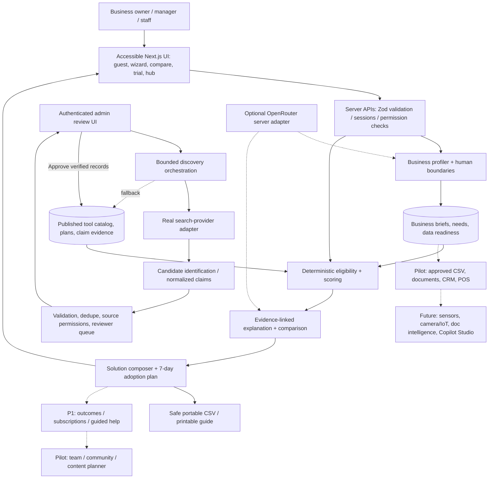

# SABKA AI — TECHNICAL ARCHITECTURE AND DATA CONTRACTS

**Principle:** A modular single deployable application is preferred for the weekend. Clear modules today enable separate background workers/AI adapters later. The model reasons about text; deterministic code enforces money, eligibility, authorization and evidence state.

## 1. Complete architecture (target, with phase labels)



**Plain-language user flow**

```mermaid
flowchart LR
  A[Tell us about your business] --> B[Choose the work you need help with]
  B --> C[Show your current tools and what stays human]
  C --> D[Review and correct our understanding]
  D --> E[See readiness and vetted matches]
  E --> F[Compare costs, evidence and limitations]
  F --> G[Choose existing / one / verified connected solution]
  G --> H[Run a reversible seven-day trial]
  H --> I[Keep, change or stop]
  I --> J[Return to SABKA AI business hub]
```



## 2. Implementation architecture

If no existing repo:
- **Web stack:** Next.js App Router, TypeScript strict, Tailwind CSS and semantic accessible React components; install limited supporting packages, not a UI kitchen sink.
- **Backend:** Next.js route handlers/server actions with Zod validation. Domain code grouped in `/lib/domain` and `/lib/server` (or equivalent); pure matcher functions independently tested. No separate microservice for the MVP.
- **Persistence:** Supabase Postgres if configured. Provide SQL migrations, versioned seed data, explicit publication status and admin restrictions. For a credential-free fresh start, maintain an in-repo **labeled fictional seed** and local session storage, without claiming it is reviewed real-world vendor data. Allow a published catalog snapshot, correctly labeled, to work when the database/network is unavailable.
- **LLM:** Optional OpenRouter server adapter for text-to-brief and wording from evidence, with structured schemas and per-request budgets. Fallback to structured form inputs/template explanations. Never pass unnecessary user-sensitive text and never allow the LLM to override critical hard gates.
- **Search:** Real, server-side provider adapter (e.g., a licensed/authorized search API configurable through env). If unavailable, show a genuine unavailable state and rely on previously reviewed published catalog. No hidden fake search response. Search call from admin only. Do not treat OpenRouter as a web-search key.
- **Admin:** protected `/admin/discovery` for bounded search, candidate inspection, reviewer approve/hold/reject with audit event. Environment allowlisted admin credentials or an auth provider are required; never use a guessable public access URL or client-only toggle as the gate.
- **Deployment:** single Next.js deployment for weekend if possible; Supabase optional managed database. Record setup in README and verify public judge guest route independently.

## 3. Data structures and dependencies

| Entity | Core fields |
|---|---|
| `business_profiles` | session id, business type, role, size band, optional region, tech comfort, consent flags |
| `business_needs` | job enum, problem, priority, frequency, spending cap, setup cap, current tools, channels, success measure |
| `human_boundaries` | approval before external action, preferred tone, owner-supplied facts, prohibited automation, relationship goals |
| `data_sources` | format/source, owner, availability, field completeness, permission, sensitivity, readiness gaps |
| `tools` | canonical vendor/product, aliases, relevant jobs, published/draft/rejected state, reviewed version |
| `tool_plans` | tier/region/currency, price, renewal/billing interval, seat/usage limit, source, checked date |
| `sources` | provider, URL, source type, license/access basis, allowed storage/display, attribution, retention and cache limit |
| `tool_claims` | tool/plan, field/key/value, source id, status, observed at, expiry, reviewer, conflict resolution |
| `discovery_runs` | admin id, request/query, provider, status, timestamps, candidates, errors, quota usage |
| `discovery_candidates` | canonical dedup identity, extracted claims, source citations, review state, reviewer action |
| `integration_edges` | from/to tool or human step, transport method, schema, plan/prerequisites, tested status, failure path |
| `solution_recipes` | ordered nodes, explicit human checkpoints, integration edge ids, total cost and assumptions |
| `recommendation_runs` | profile hash, tool catalog version, matcher version, excluded/eligible and reasons, fit breakdown |
| `adoption_plans` | selected choice, baseline, setup tasks, safe test, review steps, success measure, cost, exit path |
| `trial_feedback` | opt-in result, measured vs self-reported, setup effort, keep/change/stop, anonymity scope |
| `community_cases` | moderated consented business context, generalized outcomes, verification class, reporting concerns |
| `team_members` | future account workspace id, role, specific action permissions |
| `audit_events` | admin/consent/publication changes without storing sensitive user text |

For P0, implement only the tables and fields needed for user journey, catalog/evidence, discovery review, ranking and adoption. Write schema/migration contracts for future tables but do not develop them prematurely. Keep known unknowns explicit and do not fill `price=0` when not verified.

## 4. Recommended module/API surface

API routes are representative; choose a consistent, small contract after repo inspection:

| Endpoint | P0 purpose |
|---|---|
| `POST /api/briefs/interpret` | Optional validated text -> proposed fields, uncertainties; fallback structured entry |
| `POST /api/recommendations` | Returns published, eligible/blocked, scores, evidence categories, version and explanations |
| `GET /api/tools` | Filtered published catalog; no draft candidate leakage |
| `GET /api/tools/:id/evidence` | Claim-level source and timestamp with plan/region |
| `POST /api/adoption-plans` | Validated choice -> 7-day plan with checkpoints and exit steps |
| `GET /api/adoption-plans/:id/csv` | Portable, formula-safe CSV; guest plan must not leak across sessions |
| `POST /api/admin/discovery-runs` | Auth-only real bounded search and candidate ingest |
| `GET /api/admin/candidates` | Auth-only review queue |
| `POST /api/admin/candidates/:id/review` | Auth-only approve/hold/reject, source and verification checks |
| `POST /api/trial-feedback` | Optional P1, opt-in outcome |

If persistence isn't configured, show user-friendly, truthful states. Demo mode may work locally with explicit sample fixtures; no private admin functionality should become public to make demo easy.

## 5. Real discovery pipeline

**Input:** normalized job, constraints, existing systems, selected provider, configured search budget. **Flow:**
1. Produce 2–3 bounded query templates: feature discovery, system compatibility, independent experience.
2. Call real search provider through server with API key; record query, provider, retrieval time and response limitations.
3. Resolve canonical vendor and product identity; avoid similarly named products and company-vs-product confusion.
4. Fetch/reference only pages the provider and site permit; prioritize official pricing/docs/privacy, then permitted independent sources; never scrape Reddit/Trustpilot without legal access.
5. Extract candidate claims into structured fields; treat the LLM output as untrusted proposed content; validate URLs, types, plan scope, dates and contradictions.
6. Deduplicate by canonical vendor/product/plan; attach individual `tool_claims` to `sources`.
7. Place candidate into `pending_review`. Admin inspects source, permission, applicability and claim status; approves/holds/rejects explicitly.
8. Only **approved/published** tools are eligible for owner recommendations. Publish atomically with version and audit entry.
9. Stale important claims are demoted; provider outage returns saved last-reviewed catalog, visibly indicating freshness.

Example status vocabulary: `discovered_unreviewed`, `pending_review`, `published`, `held`, `rejected`, `expired`; claims use `documented`, `team_tested`, `user_reported`, `unknown`, `conflicting` with timestamps and actor. “Documented” is not equivalent to an independent audit.

A review platform's rating can be presented by its native scheme only with appropriate permission, review count and date; do not average Reddit upvotes and Trustpilot or convert to an invented `trust=96%`.

## 6. Matching algorithm — required exact MVP policy

```text
1. Validate business brief / constraints.
2. Select only published tools + plan claims applicable to this job/region/tier.
3. For every tool, apply hard gates:
   - required capability supported in the applicable plan?
   - verified total incremental monthly cost <= hard budget? (unknown cost = Needs verification)
   - required native integration supported, OR owner explicitly accepts verified manual/CSV route?
   - required human-approval mechanism supported?
   - critical data/privacy constraints verified and not contradicted?
   - sensitive/regulated problem excluded from unsupported automation?
4. Create explicit BLOCKED / NEEDS_VERIFICATION lists with actual reasons.
5. For eligible tools only, grade 0–4 per dimension:
      job capability                30 points
      ease/accessibility           25 points
      existing-process compatibility 20 points
      total incremental cost       15 points
      human control/reversibility  10 points
   score = sum(points * grade / 4); unknown soft grade = 0 with unknown flag.
6. Evidence coverage checklist:
   a) current official plan facts
   b) current relevant policy/control evidence
   c) reproducible internal task test
   d) relevant independent experience
   e) second origin corroboration
   High: >= 4, including a and c, no unresolved critical conflict.
   Moderate: 2–3 checks; Limited: fewer than 2.
   Low evidence may cap label at Possible fit, but never masks hard gate failure.
7. Display risk as specific plain-language caveats, not a single fake safe/unsafe badge.
8. Rank reproducibly by score, then fewer unknowns, easier setup, lower cost;
   near-tie <=5 points: show tradeoff, not false certainty.
9. Always permit existing-tools-first / do-not-adopt-yet fallback.
10. Include selected plan, score-rubric version, catalog version and source links.
```

Suggested display labels: Strong fit (80–100 with adequate evidence), Possible fit (60–79 or limited evidence), Weak fit (<60). Score is a match heuristic **not a predicted success probability**. Do not call evidence label an external trust rating.

**Sample fictional constraint input**:

```json
{
  "business_type": "home_bakery",
  "role": "owner",
  "job": "customer_reply_drafting",
  "monthly_incremental_budget_usd": 40,
  "current_systems": ["whatsapp", "notebook", "spreadsheet"],
  "required_integrations": [],
  "manual_handoff_allowed": true,
  "human_approval_required_before_send": true,
  "technical_comfort": "beginner",
  "customer_data_sensitivity": "standard",
  "presentation": {"focus_view": true, "large_text": true}
}
```

Tests must cover budget changes, approval-required exclusions, missing price, unavailable integration, unknown privacy, missing reviews, published vs draft, unsupported job and deterministic repeat ranking. Do not make a demo seed’s invented scores look like vendor documentation.

## 7. Data readiness decision logic

Use normalized known sources and needs. Present: `what you already have`, `what is missing`, `smallest useful next step`, `sensitive data warnings`. For order management, a notebook/WhatsApp workflow may need a spreadsheet rather than a model. Sensors or camera collection appear only if paper, existing exports, forms, and supported connectors cannot satisfy a validated requirement. This is a future recommendation ladder, not device sales.

## 8. Multi-tool recipe graph

Each node = business tool, owner approval or data step. Each edge = exact transfer method and compatible inputs/outputs (native API / tested CSV / tested copy-paste / manual). Include plan, extra fees, consent, reviewer and failure path. If unverified, mark **proposed, not deployable**. P0 should demonstrate one credible manual CSV workflow. P1 may implement one verified two-tool recipe. Do not count already owned subscription twice.

## 9. Security, resilience and access

- Public guest app only reads published data; admin publish is authenticated server-side.
- API keys only on server; env examples use placeholders, rate limits, budget caps, meaningful provider-outage states.
- Strict Zod schemas before model output, external search data, database writes and API responses.
- Untrusted webpage content is evidence data, never instructions; prevent prompt injection, unsafe redirects and SSRF (including loopback/private addresses), restrict protocols, response bytes and timeouts.
- Unknown critical product claims block positive recommendations; expired claims cannot be silently used as current.
- CSV formula injection defense; no PII/customer data in logs, tests or demo fixtures.
- Use managed DB least privilege/RLS if Supabase; no service-role key in browser.
- Idempotent search runs and candidate dedup; bounded retries/backoff; descriptive loading/error states.
- Auth/session isolation, source provenance, change audit, backups and rollback preparation.
- Opt-in community sharing and future multimedia processing require explicit consent/retention and moderation.
- Offline mode in later PWA supports already saved guidance only; never pretend live discovery can function offline.

## 10. Interface and performance budgets

P0 should render a usable landing/onboarding experience with no third-party credential dependency. Ranking deterministic offline against a legitimately labeled sample dataset; production published catalog depends on reviewed evidence. Aim for near-instant local form steps and a sub-two-second cached recommendation response as a target, not a measured claim. Run build/tests and record actual outcomes. Avoid huge animations, unnecessary dependency bundles and duplicate client network fetches.

## 11. Phased evolution

P0: single deployable UI/server, real database when configured, published source catalog, one real admin discovery adapter, constraints/matching, simple readiness, trial/export. P1: one verified integration recipe and trial feedback. Sixteen-week pilot: product catalog refresh workers, permissions/team collaboration, accessible opt-in media ingestion, peer outcomes, content planning, cost/subscription tracker, local assistance links, app guidance and tested business data connectors. Future research: document intelligence/Copilot Studio, camera/IoT/sensors, advanced learning-to-rank and richer API integrations only when evidence and owner value justify complexity.
